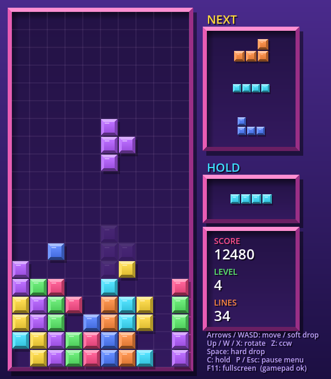

# Block Drop

A Tetris-style falling block game built with [Godot 4](https://godotengine.org). Everything — rendering, menus, particles and sound effects — is done in a single GDScript file, with no external assets.



## Features

- All seven tetrominoes with a 7-bag randomizer
- Next-piece preview, hold, ghost piece and hard drop
- Wall kicks, lock delay and DAS/ARR for responsive movement
- Scoring, levels and increasing gravity, with a saved best score
- Title screen with selectable start level, pause and game-over menus
- Line-clear particle effects and synthesized sound effects
- Keyboard, mouse (menus) and gamepad support
- Fullscreen toggle

## Controls

| Action | Keyboard | Gamepad |
| --- | --- | --- |
| Move left / right | ← → / A D | D-pad / left stick |
| Soft drop | ↓ / S | D-pad down / left stick |
| Rotate clockwise | ↑ / W / X | A / RB |
| Rotate counter-clockwise | Z / Ctrl | B / LB |
| Hard drop | Space | D-pad up / Y |
| Hold | C / Shift | X |
| Pause menu | P / Esc | Start |
| Restart | R | Back |
| Fullscreen | F11 / Alt+Enter | — |

## Running

1. Install [Godot 4.7](https://godotengine.org/download) or newer.
2. Clone this repository.
3. Open the project in Godot (import `project.godot`) and press **F5**, or run from the command line:

   ```sh
   godot --path .
   ```

## Project structure

| File | Description |
| --- | --- |
| `tetris.gd` | All game logic, drawing, input, menus and sound synthesis |
| `main.tscn` | Main scene — a single `Node2D` running `tetris.gd` |
| `project.godot` | Godot project settings |
